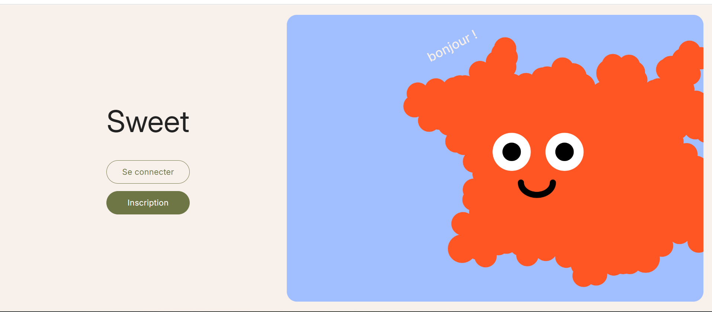
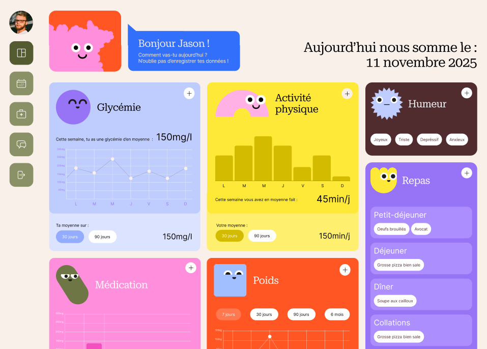
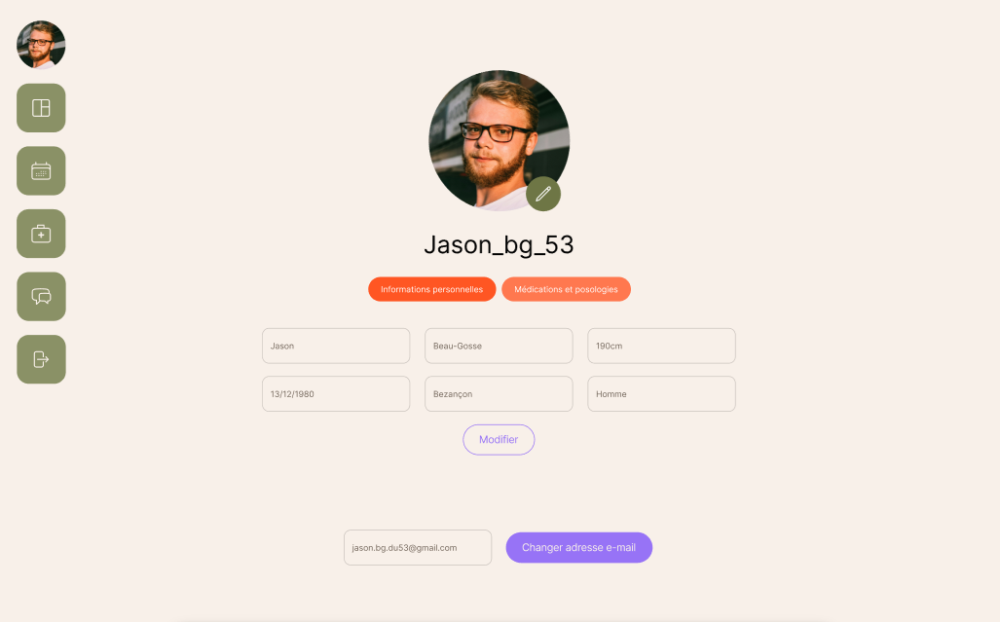

# SWEET — Application web de suivi du diabète

*[Read in English](README.md)*

**SWEET** est une application web qui permet aux personnes diabétiques de centraliser
le suivi de leurs habitudes et indicateurs de santé au quotidien.

Projet personnel développé en fin de formation chez **Holberton School** —
candidat au concours **La Mayenn' Innove** (catégorie étudiante, résultat en attente).

👉 [Voir la landing page](https://helvlaska.github.io/sweet-presentation/)

---

## 📸 Aperçu








---

## ✨ Fonctionnalités

### Disponibles

- **Dashboard** — suivi de la glycémie, du poids, de l'activité physique,
  des médicaments, de l'humeur et des repas, avec statistiques et graphiques
  (min / max / moyenne, filtres jour · semaine · mois)
- **Carnet médical** — répertoire de professionnels de santé (16 spécialités),
  prises de notes et documents joints par professionnel
- **Gestion de profil** — informations personnelles et suivi des médicaments
  avec alertes de stock bas
- **Blog** — articles lifestyle publiés par les administrateurs, avec système de likes
- **Authentification** — inscription multi-étapes, connexion sécurisée

### En cours d'implémentation

- **Forum communautaire** — espace d'échange entre utilisateurs
- **Calendrier médical** — gestion des rendez-vous et modification des données de santé

---

## 🛠️ Stack technique

| Couche | Technologies |
| -------- | ------------- |
| Backend | Python · Flask · SQLAlchemy |
| Frontend | React · JavaScript · SCSS · Chart.js |
| Base de données | MySQL (prod) · SQLite (dev) |
| Outils | Git · Postman · Figma · Pytest |

---

## 🏗️ Architecture

```bash
sweet/
├── backend/        # API REST Flask
│   ├── models/     # Modèles SQLAlchemy
│   ├── routes/     # Endpoints API
│   ├── services/     # Services API
│   └── config/     # Configuration & variables d'environnement
├── frontend/       # Application React
│   ├── components/ # Composants réutilisables
│   ├── pages/      # Pages principales
│   ├── styles/     # Styles de base
│   └── assets/     # Illustration
└── docs/           # Documentation technique & captures d'écran
```

---

## 🚀 Lancer le projet en local

### Prérequis

- Python 3.10+
- Node.js 18+
- MySQL 8+

### Installation

```bash
# Cloner le repo
git clone https://github.com/Helvlaska/sweet.git
cd sweet

# Backend
cd backend
pip install -r requirements.txt
cp .env.example .env  # Renseigner les variables d'environnement
flask db upgrade
flask run

# Frontend (dans un autre terminal)
cd frontend
npm install
npm start
```

---

## 🗺️ Roadmap

- [x] MVP — authentification, dashboard, profil, blog
- [x] Carnet médical avec documents joints
- [x] Alertes médicaments stock bas
- [ ] Forum communautaire
- [ ] Calendrier médical
- [ ] Tests utilisateurs — recrutement d'une trentaine de testeurs en cours
- [ ] Interviews de professionnels de santé pour identifier les axes d'amélioration

---

## ⚠️ Version bêta — Données personnelles

SWEET est actuellement en **phase de test** et n'est pas encore destinée à un usage public.

L'hébergement actuel **ne dispose pas de la certification HDS** (Hébergeur de Données de Santé)
requise pour stocker des données médicales sensibles en production.

À ce stade, il est fortement déconseillé de saisir de vraies données de santé.
SWEET ne se substitue pas à un suivi médical professionnel.

---

## 👩‍💻 Auteure

**Claire Castan** — Développeuse web en recherche d'alternance RNCP6
💼 [LinkedIn](https://www.linkedin.com/in/claire-castan) · 🐙 [GitHub](https://github.com/Helvlaska)
