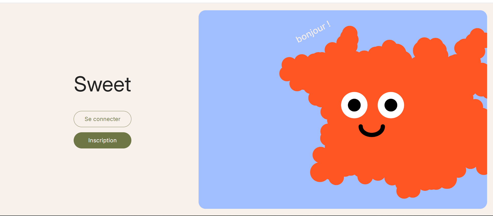
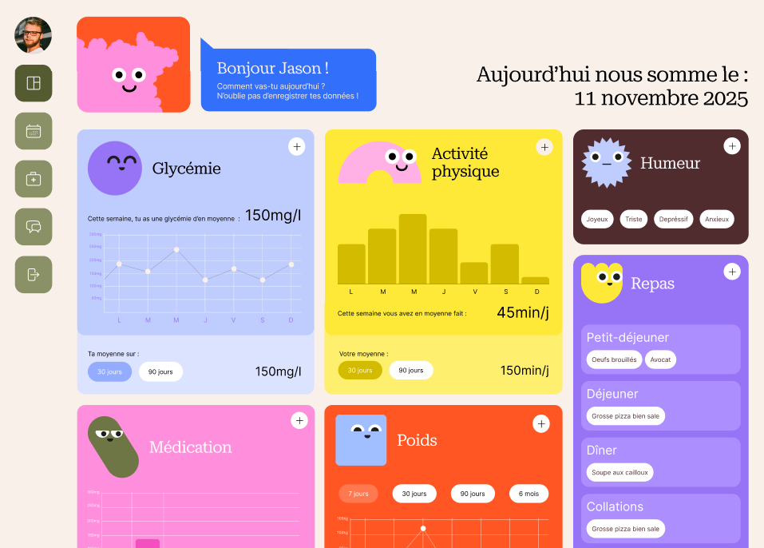
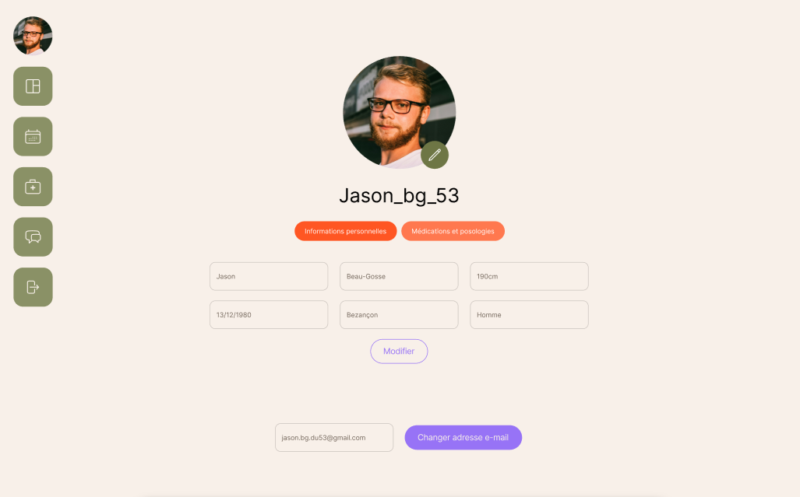

# SWEET — Diabetes Tracking Web Application

*[Lire en français](README.fr.md)*

**SWEET** is a web application that helps people with diabetes centralize the tracking of their daily health habits and indicators.

Personal project developed at the end of my training at **Holberton School** —
submitted to the **La Mayenn' Innove** competition (student category, result pending).

👉 [View the landing page](https://helvlaska.github.io/sweet-presentation/)

---

## 📸 Preview








---

## ✨ Features

### Available
- **Dashboard** — blood glucose, weight, physical activity, medication, mood and meal tracking, with statistics and charts (min / max / average, day · week · month filters)
- **Medical records** — directory of healthcare professionals (16 specialties), consultation notes and attached documents per professional
- **Profile management** — personal information and medication tracking with low stock alerts
- **Blog** — lifestyle articles published by administrators, with a like system
- **Authentication** — multi-step registration, secure login

### In progress
- **Community forum** — space for users to exchange
- **Medical calendar** — appointment management and update health data entry

---

## 🛠️ Tech Stack

| Layer | Technologies |
|-------|-------------|
| Backend | Python · Flask · SQLAlchemy |
| Frontend | React · JavaScript · SCSS · Chart.js |
| Database | MySQL (prod) · SQLite (dev) |
| Tools | Git · Postman · Figma · Pytest |

---

## 🏗️ Architecture

```
sweet/
├── backend/        # Flask REST API
│   ├── models/     # SQLAlchemy models
│   ├── routes/     # API endpoints
│   ├── services/   # API services
│   └── config/     # Configuration & environment variables
├── frontend/       # React application
│   ├── components/ # Reusable components
│   ├── pages/      # Main pages
│   ├── styles/     # Basics styles
│   └── assets/     # Illustration
└── docs/           # Technical documentation & screenshots
```

---

## 🚀 Run locally

### Prerequisites
- Python 3.10+
- Node.js 18+
- MySQL 8+

### Installation

```bash
# Clone the repo
git clone https://github.com/Helvlaska/sweet.git
cd sweet

# Backend
cd backend
pip install -r requirements.txt
cp .env.example .env  # Fill in environment variables
flask db upgrade
flask run

# Frontend (in a separate terminal)
cd frontend
npm install
npm start
```

---

## 🗺️ Roadmap

- [x] MVP — authentication, dashboard, profile, blog
- [x] Medical records with attached documents
- [x] Low stock medication alerts
- [ ] Community forum
- [ ] Medical calendar
- [ ] User testing — currently recruiting ~30 testers
- [ ] Interviews with healthcare professionals to identify key improvement areas

---

## ⚠️ Beta version — Personal data

SWEET is currently in **beta testing** and is not intended for public use.

The current hosting **does not hold HDS certification** (Hébergeur de Données de Santé — French health data hosting standard) required for storing sensitive medical data in production.

At this stage, entering real health data is strongly discouraged.
SWEET is not a substitute for professional medical monitoring.

---

## 👩‍💻 Author

**Claire Castan** — Web developer seeking a 2-year work-study contract (RNCP6)
💼 [LinkedIn](https://www.linkedin.com/in/claire-castan) · 🐙 [GitHub](https://github.com/Helvlaska)
